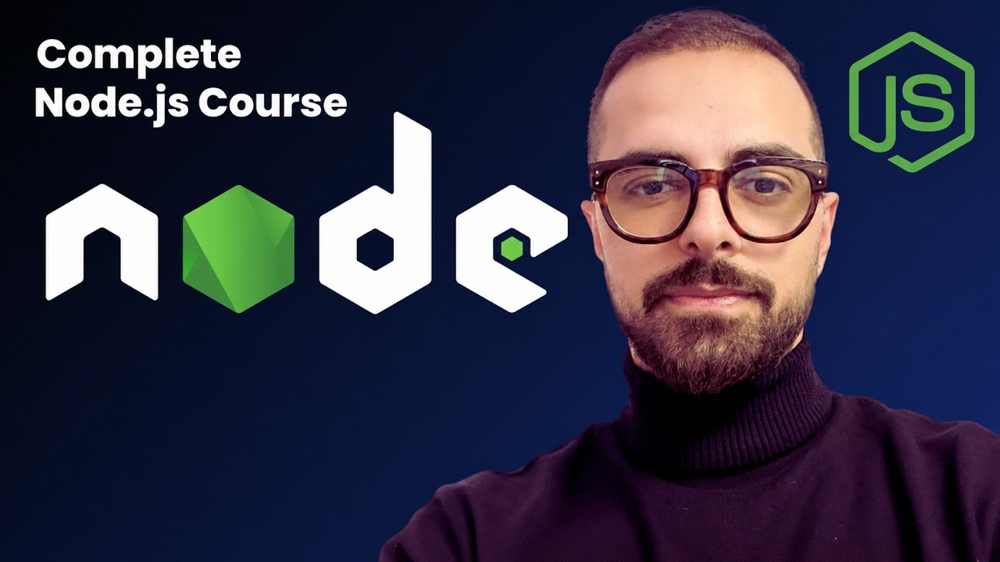

# CLAUDE CODE EVERY THING YOU NEED TO KNOW: Material

> [!IMPORTANT]
> **Watch the full course on YouTube:** [https://www.youtube.com/playlist?list=PLJv22rmYzZEk](https://www.youtube.com/playlist?list=PLJv22rmYzZEk)

Slide decks (PDF) for the course, one per day.

| File | Content |
|------|---------|
| `Nodejs-Everything-You-Need-to-Know-1.pdf` | Day 1 |
| `Nodejs-Everything-You-Need-to-Know-2-Part-01.pdf` | Day 2, Part 1 |
| `Nodejs-Everything-You-Need-to-Know-2-Part-02.pdf` | Day 2, Part 2 |
| `Nodejs-Everything-You-Need-to-Know-3.pdf` | Day 3 |
| `Nodejs-Everything-You-Need-to-Know-4.pdf` | Day 4 |
| `Nodejs-Everything-You-Need-to-Know-5.pdf` | Day 5 |

Open any PDF directly on GitHub or download the repo.
